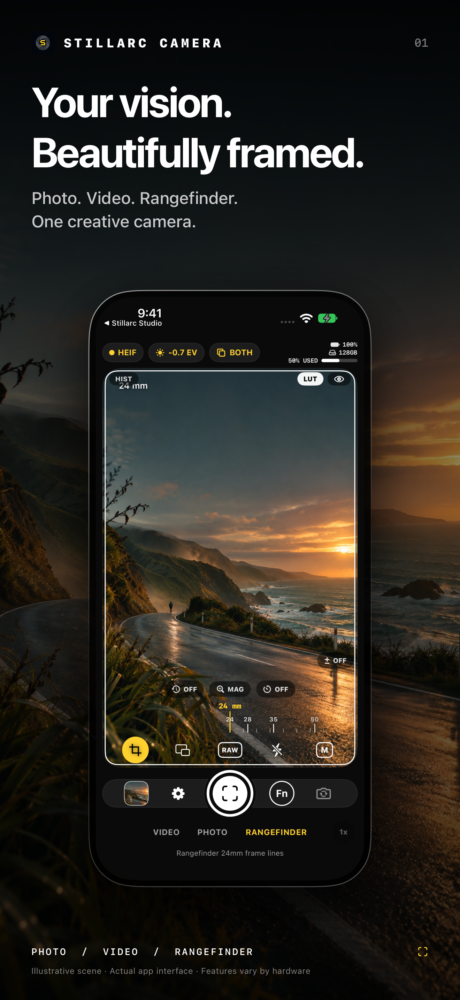
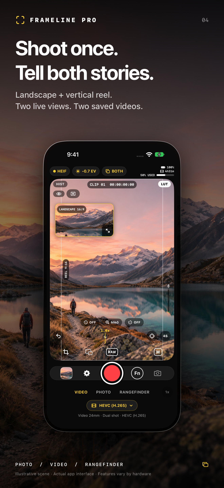
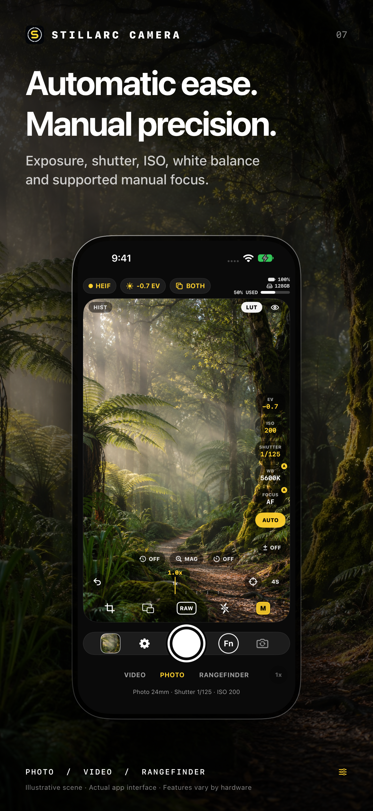

# FrameLinePro

**Your vision. Beautifully framed.**

A creative camera for iPhone: natural photography, expressive video, and a rangefinder way of seeing. FrameLinePro brings live looks, manual controls, exposure aids and two-format recording into one considered interface.

[Download the Xcode project](https://github.com/edwinmuronzi/FrameLine-Pro/archive/refs/heads/main.zip) · [Marketing images](Marketing/AppStore) · [Releases](https://github.com/edwinmuronzi/FrameLine-Pro/releases) · [Report an issue](https://github.com/edwinmuronzi/FrameLine-Pro/issues)

<p align="center">
  
  
  
</p>

## Download and install on iPhone

**Current availability: source installation with a Mac and Xcode.** There is no public App Store or TestFlight installation link yet. The project currently uses a free Apple Personal Team. A source ZIP is not an iPhone installer, and an unsigned IPA cannot be installed just by opening it in Safari.

### Install with your free Apple Account

1. Use a Mac capable of running **Xcode 27.2 or newer**. Install Xcode from Apple and open it once to finish installing its components.
2. [Download this project](https://github.com/edwinmuronzi/FrameLine-Pro/archive/refs/heads/main.zip) and unzip it, or clone it:
   ```sh
   git clone https://github.com/edwinmuronzi/FrameLine-Pro.git
   ```
3. Open **FrameLinePro.xcodeproj** in Xcode. Select the **MyApp** scheme.
4. In **Xcode → Settings → Accounts**, add your own Apple Account. Keep your credentials private.
5. Select the **FrameLinePro** target, open **Signing & Capabilities**, enable automatic signing, and select **your Personal Team**. Change the bundle identifier to a unique value you control, for example `com.yourname.FrameLinePro`. Select your team for **LockCapture** and **CameraControlWidget** too; give those targets matching prefixes and unique suffixes, such as `com.yourname.FrameLinePro.LockCapture` and `com.yourname.FrameLinePro.CameraControlWidget`.
6. Connect your iPhone, unlock it, and trust the Mac if asked. The phone must run **iOS 26 or newer**.
7. Select the phone as the run destination and press **Run (⌘R)**. If iOS asks, enable **Developer Mode** under Settings → Privacy & Security, restart, and confirm. Follow any developer-trust prompt shown by iOS.
8. Open FrameLinePro, explore or skip the feature tour, then allow camera access. Microphone access is needed for sound in videos; Photos access is needed to save into your library.

Personal Team signing expires periodically. If the development app stops opening, connect the phone and run it from Xcode again. This method needs a Mac; there is currently no supported phone-only public install.

### Public beta and App Store release

Public distribution is the next publishing step, **not currently enabled**. The owner needs Apple Developer Program membership, App Store Connect access, distribution signing, a processed uploaded build and the applicable Apple review. External TestFlight testing also needs a tester group and a public invitation link.

When available, this section will contain the real TestFlight/App Store link. See [Apple’s distribution guide](https://developer.apple.com/documentation/xcode/distributing-your-app-for-beta-testing-and-releases/) and [external TestFlight instructions](https://developer.apple.com/help/app-store-connect/test-a-beta-version/invite-external-testers).

## New in 1.2

### Photo capture: choose the result you want

Open **Fn → Shooting tools → Photo capture**. Standard, Natural RAW, Live Photo and depth portrait are alternative capture modes, not switches that promise every combination at once.

- **Standard:** the quickest everyday HEIF/JPEG path, with optional RAW and looks.
- **Natural RAW:** develops a single native Bayer RAW with sharpening, noise reduction and local tone mapping turned down, retaining the DNG. This gives you more control over texture. It can be grainier, and bright skies or dark scenes may be harder to recover. It uses a supported physical rear camera; it is not ProRAW-based HEIF+ and does not claim to reproduce another app’s proprietary processing. The live preview is a framing/color preview, not an exact preview of the later RAW development.
- **Live Photo:** keeps a short moment of movement with the still and saves one paired Live Photo to Photos. It preserves the original full frame and metadata; baked looks/LUTs and framing crops are excluded. In-app sharing of the motion component sends a separate movie. Microphone availability and permissions affect sound.
- **Depth portrait:** uses a supported camera’s distance map to soften the background while preserving the original. It is a rendered image, not Apple’s editable Portrait mode. Hair, glass and complex edges can be imperfect. An unsupported lens retains the original and explains what happened.

The format pill identifies Natural RAW, Live Photo or Depth when active. Supported RAW, Live and depth combinations depend on the actual lens, format and capture session. For the fastest repeated stills, use Standard HEIF with these extras off.

### Focus pulls without leaving the viewfinder

A **focus pull** moves sharpness from one subject to another while filming—for example, from a cup in front to a person behind it.

1. In **Video**, tap the focus-target icon beside the eye button under HIST, or choose **Fn → Shooting tools → Focus pulls → Set A and B in the viewfinder**.
2. Tap the first subject to save **A**, then the second to save **B**. The app waits for autofocus to settle without changing exposure.
3. Tap A or B to move smoothly to that distance. Choose the time from the duration control, or move the slider for manual control.
4. Set marks before recording. The setup uses a fixed physical rear lens; unsupported lenses explain the limitation. Close the strip to return to autofocus.

A/B marks remember focus distances. They do **not** track a person who moves closer or farther away. Focus peaking and magnification can help you check the result.

### A gallery you can return to

Captures, original files and edit recipes stay in the app after closing it. Open a photo and choose **Develop photo** to change the look, brightness, color strength or warmth. The full-resolution original is retained; edits are separate. When a full-frame original and RAW are available, enable **Develop from RAW** to adjust exposure in the digital negative before rendering. A smaller draft preview keeps editing responsive; the saved edit uses the full RAW. Frame-only captures can still be edited from their original crop and their DNG shared separately. Reopen Develop photo to revise the saved recipe, or switch to Original in the viewer. Sharing sends the displayed version at full resolution. Saving an edit does not silently overwrite the copy already in Photos.

The gallery is local to this installation, not an online backup. Deleting a capture removes its app files; copies already saved to Photos remain there. Locked-screen captures transfer into the app gallery after unlocking; export/share them from there when needed.

### Your shortcuts, within reach

Use **Fn → Shooting tools → Viewfinder shortcuts** to choose the three buttons above the zoom ruler. Available choices include countdown, timelapse, magnifier, histogram, looks, manual controls, gallery and focus pulls. Picking a duplicate swaps its old position so the row stays clean. Reset restores the original arrangement.

### Lock Screen camera

Long-press your Lock Screen, choose **Customize**, replace a bottom control and select **FrameLine camera**. You can also add its control in Control Center. The locked camera is a separate, simple photo experience: it cannot browse your gallery or expose previous images. Tap its open-app button to authenticate and open the full app. After unlocking, new photos are imported into FrameLinePro’s gallery. Camera permission must be granted; the system controls authentication and extension availability.

### Plain-English camera guide

**Fn → Shooting tools → Camera guide** explains the tools without assuming camera knowledge. For quick reference:

| Control | What it does |
| --- | --- |
| EV / brightness | Makes automatic exposure lighter or darker. |
| ISO | Raises sensitivity to brighten the image, often adding noise. |
| Shutter | Changes how long each frame gathers light; slower speeds blur motion. |
| White balance | Keeps whites neutral or deliberately warmer/cooler. |
| Focus / A–B pull | Chooses which distance appears sharp. |
| LUT / Bake | A saved color transformation; Bake writes it into the output. |
| Histogram / waveform | Shows the distribution or position of brightness, helping spot clipped highlights. |
| Zebra | Stripes areas above a brightness threshold. |
| Peaking | Outlines sharp edges to help judge focus. |
| False color | Replaces the scene’s colors with a brightness guide. |
| RAW | Sensor-oriented data with room for later development; larger and slower than ordinary photos. |
| Depth portrait | Softens the background using measured distance information. |

## Three ways to make an image

### Photo — natural detail, personal color

- HEIF and JPEG capture, with **HEIF Max** and **RAW** where the selected camera supports them.
- Repeated shutter presses use independent capture requests. Grading and thumbnail creation happen away from the interface, with bounded processing to protect memory.
- Automatic exposure when you want simplicity; manual controls when you need precision.
- Live camera styles, custom look recipes, and optional LUT baking.
- Full-frame, framed crop, or both; full-resolution files remain available from the gallery.
- Countdown, exposure bracketing, still timelapse, grid, level and focus magnifier.

HEIF Max, RAW, flash, low-light processing and bracketing take longer than ordinary stills. Responsive/zero-shutter-lag capture is enabled only where supported; timing remains dependent on the camera, format and light. There is no claim of unlimited full-resolution burst capture.

### Video — motion with intention

- Resolution, frame rate, bitrate and codec choices discovered from the active camera.
- **Apple Log, Apple Log 2 and ProRes** on compatible devices, lenses and formats. Unsupported combinations are not universal features.
- Exposure, white balance, shutter angle and supported focus control.
- Live styles and enabled LUT baking while recording on the live grading path.
- RGB histogram/waveform and exposure/focus aids available while recording.
- Microphone selection, audio level/clipping indication and headphone monitoring.
- Torch control on supported cameras, including during recording.
- Clean recording controls, clip counters and running timecode.

### Rangefinder — see beyond the crop

Choose frame lines using the focal-length ruler while keeping the wider scene visible. Anticipate the next subject entering the composition, then save the full image, the framed crop, or both. These are digital framing/crop controls, not a promise of a different physical lens or optical focal length.

## Dual Shot: one take, two finished videos

Record **landscape 16:9 and vertical 9:16 simultaneously from one camera source**. A movable, resizable live landscape window sits inside the main reel viewfinder so you can judge both compositions.

- Two finished files: **1920×1080 landscape** and **1080×1920 vertical**.
- A camera style is baked into the pair. A selected LUT is baked only when its bake control is enabled.
- No style and no baked LUT means a plain pair.
- Optional subject tracking moves the reel crop independently; the landscape framing stays centered.
- Optional reel safe-zone guides help leave room for captions. Guides and tracking boxes do not appear in saved videos.
- Both outputs are committed together to Photos after successful finalization. Incomplete pairs are not deliberately published.

Dual Shot is two crops of one source, not two independently pointed cameras. It does not create four copies, and it does not deliver two 4K files. Available framing is limited by what the camera can see.

## Looks, LUTs and shooting presets

**Looks** are the camera’s visual recipes: color, tone, grain, softness, glow, vignette and other supported adjustments. Use **Fn → Looks / Look Studio** to explore built-in styles, make your own, and adjust the Quality and Tone dials.

**LUTs** are imported `.cube` color transforms. Use the **LUT** pill to select a transform and adjust its mix. Preview and baking are independent: seeing a LUT in the viewfinder does not, by itself, mean it will be written into a file. The LUT pill is yellow when baking is active and white otherwise. Hold/tap A/B to compare against the original preview.

**Shooting presets** remember a setup, including format, exposure, white balance, focus, lens/zoom, style/LUT, Dual Shot, framing and audio choices. Use **LUT → Save Preset** or **Fn → Shooting tools → Shooting presets**. The selected preset is yellow. Changing its setup clears the selection; automatic exposure/focus readings do not. Photo capture modes are included in saved presets. Apply presets between recordings. A referenced custom look or LUT must still be available.

### What saves

- Stills without a look/baked LUT save the plain output(s) you selected.
- With a look or baked LUT, the graded selected output(s) save to Photos; originals remain available in the app’s gallery.
- Identical full-frame/crop outputs are not intentionally duplicated.
- RAW capture also preserves a separate DNG where supported.
- Dual Shot saves the final two-video pair described above.
- The gallery and edit recipes persist between launches. Previews load from files as needed; recent in-memory previews are bounded. Share uses full-resolution files. App deletion removes its local gallery, so save important work to Photos or export it; this is not a cloud backup.

## Tools that stay out of the way

| Tool | Where / purpose |
| --- | --- |
| **M** | ISO, shutter, EV, white balance and supported focus; use auto where preferred |
| **HIST** | RGB exposure histogram, including during recording |
| **Eye** | Compact waveform, zebra, peaking and false-color switches; clean feed |
| **MAG** | Focus magnifier |
| **Fn → Shooting tools** | Presets, tracking, focus pulls, safe zones, anamorphic and audio |
| **Subject tracking** | Tap a subject in Dual Shot’s reel; autofocus can follow while AF is enabled |
| **Focus pulls** | Set two marks and a duration. Fixed-lens mode uses supported rear 1×/2× framing; turn it off to return to all-lens zoom |
| **Anamorphic desqueeze** | Preview correction, or explicitly saved correction for compatible video paths; requires the matching physical attachment for an anamorphic image |
| **Audio** | Select available microphone inputs; monitor through headphones/compatible output routes and watch clipping |
| **Preserve settings** | Restore the previous shooting setup and controls across launches |
| **Feature tour** | First-launch introduction; replay it from Settings |

Lens stops, stabilization, torch, RAW, Log, ProRes, manual focus and audio routes depend on the actual hardware. A focus pull cannot be promised on every virtual camera or lens. Anamorphic preview correction alone does not alter a saved file; raw Log paths without grading may remain preview-only.

## First launch and everyday use

The fifteen-page introduction showcases photography, video, Dual Shot, live looks, rangefinder composition, manual controls, exposure aids shooting tools, Natural RAW, Live Photo/depth portrait, re-editable originals, viewfinder focus pulls and locked capture. It is skippable and replayable, uses frosted native glass, respects reduced-motion preferences for its transitions, and keeps the live camera off until you enter the camera.

- Tap the bare viewfinder to focus; hold to lock exposure/focus.
- Drag vertically to adjust exposure.
- Use the ruler and lens selector to reframe; supported unified rear cameras provide continuous zoom transitions.
- Use the eye panel or double-tap the viewfinder for a cleaner composition.
- Open the gallery thumbnail to compare available originals/crops/graded versions and share.

## Compatibility, performance and privacy

- **Deployment target: iOS 26.0+.** This release keeps one modern interface rather than a separate reduced iOS 16/iPhone X app.
- A phone that cannot run iOS 26 cannot install this build. Running iOS 26 also does not give older hardware newer sensors, lenses, RAW/Log/ProRes support or identical throughput.
- The current development toolchain is **Xcode 27.2**. The minimum OS is a build target, not a claim that every supported iPhone has been physically tested.
- Capture, Core Image grading and subject tracking run on the device. This build has no account system, subscription flow, analytics SDK or photo-upload service.
- Camera, microphone and Photos permissions are used for their corresponding capture/save functions. If you share through another app or use iCloud Photos, that service’s behavior is separate.
- Rendering resources are reused, photo processing is bounded, and motion/storage polling pauses in the background. The zoom ruler does not run a constant display-rate redraw while idle.
- Camera hardware, screen brightness, high resolution, tracking and grading still consume power and can warm the phone. There is no zero-heat, zero-drain or zero-lag guarantee.

The marketing scenes are **AI-generated illustrative photography**, not evidence that FrameLinePro captured those images. The interfaces shown are rendered from the app’s own views. Images in the Halide reference material are not redistributed as FrameLinePro assets.

## Marketing kit

Ten coordinated **1320×2868, opaque PNG** images are in [Marketing/AppStore](Marketing/AppStore), covering the main camera, photo, video, Dual Shot, looks/LUTs, rangefinder, manual controls, scopes, shooting tools and the overall experience.

The set is designed for the iPhone App Store screenshot slot; confirm [Apple’s current screenshot specifications](https://developer.apple.com/help/app-store-connect/reference/app-information/screenshot-specifications/) and your actual supported devices before submission. It is a prepared marketing set, not an App Store approval or a published listing. See [the marketing notes](Marketing/README.md) for source, copy and regeneration details.

See [validation results and remaining device checks](VALIDATION.md) for the tested scope and sustained thermal limits.

## Build and development

Open `FrameLinePro.xcodeproj`, use scheme **MyApp**, and build the **FrameLinePro** target. For everyday phone use, choose **Release** in Product → Scheme → Edit Scheme → Run → Build Configuration; Debug builds prioritize debugging over speed. Swift source is in `FrameLinePro/`. Photos and saves must be checked on real devices; simulator previews do not validate camera speed, lens transitions or thermal behavior.

```sh
xcodebuild -project FrameLinePro.xcodeproj \
  -scheme MyApp -configuration Release \
  -destination 'generic/platform=iOS' build
```

Choose your signing team before using the device build command. See [DEVELOPMENT.md](DEVELOPMENT.md) for regression checks and the build/install/push workflow.

Found an issue? Include the iPhone model, iOS version, mode, format/frame rate, look/LUT state and exact steps in [an issue](https://github.com/edwinmuronzi/FrameLine-Pro/issues). Please do not attach private photos or credentials unless you intend to share them publicly.
